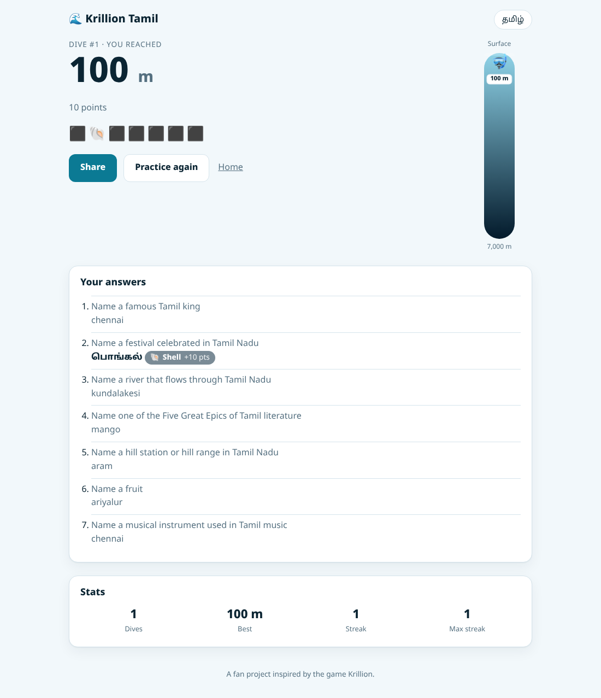
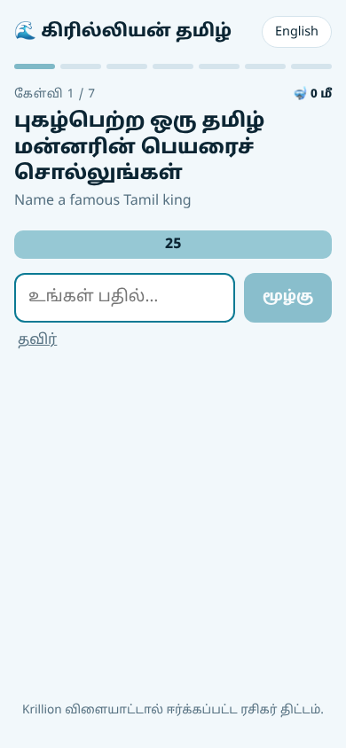

# கிரில்லியன் தமிழ் · Krillion Tamil

A daily Tamil trivia game where **being right is not enough: rare answers take you deeper.**

**Live demo:** https://psa-02.github.io/tamil-krillion/


## How it plays

Each day everyone gets the same **Daily Dive**: 7 open-ended prompts such as *"Name a district of Tamil Nadu"* or *"Name a Tamil breakfast dish"*. You have 25 seconds and one answer per prompt. Any correct answer counts, but the fewer people likely to think of it, the more it scores. Points become depth: every point is 10 metres, so a perfect dive reaches 7,000 m.

| Tier | Tamil | Points | Depth |
| --- | --- | --- | --- |
| 🐚 Shell | சிப்பி | 10 | 100 m |
| 🐟 Fish | மீன் | 30 | 300 m |
| 🪸 Coral | பவளம் | 60 | 600 m |
| 🦪 Pearl | முத்து | 85 | 850 m |
| 💎 One in a Crore | கோடியில் ஒன்று | 100 | 1,000 m |

"இட்லி" scores a Shell. "களி" is One in a Crore.

After each answer the game shows the deeper answers you missed, so every round teaches something about Tamil culture.

<p align="center"> </p>

## Features

- **Tamil-first, bilingual UI.** Tamil by default, with an English toggle; every prompt shows both.
- **Type in Tamil script or English letters.** `இட்லி`, `idli` and `idly` all match. Romanised input goes through a phonetic key (see below), and small typos are forgiven.
- **Daily Dive, the same for everyone.** Prompts are picked by a seeded PRNG from the date in India Standard Time, so there's no server and no cheating by refreshing.
- **Practice Dive.** Unlimited random dives that don't touch your stats.
- **Stats and streaks** kept in `localStorage`, with safe fallbacks when storage is blocked.
- **Spoiler-free sharing**: an emoji summary via the Web Share API or the clipboard.
- **Responsive, accessible, dark mode.** Live depth gauge, `aria-live` feedback, keyboard flow, reduced-motion support.
- **14 categories, 260+ curated answers** across geography, food, literature, film, music, history and the calendar.

## Engineering notes

**Matching romanised Tamil.** Tamil has no single romanisation: Thanjavur, Tanjavoor and Tanjore are all in the wild. `latinKey()` in [`src/lib/match.ts`](src/lib/match.ts) folds input the way Tamil script itself folds sounds: aspirates drop (`th → t`), voiced and unvoiced stops merge (`g/k`, `d/t`, `b/p`), `zh → l`, long vowels shorten and doubled letters collapse. Keys are then compared with Levenshtein distance, with a tolerance that grows with word length (0 edits under 5 letters, then 1, then 2). If two answers are equally close, the game refuses to guess rather than award the wrong one.

**Data integrity is tested.** [`src/data/prompts.test.ts`](src/data/prompts.test.ts) checks that no two answers in a prompt share a Tamil or romanised key, so adding an alias can't silently steal another answer's matches.

**Deterministic daily puzzles.** [`src/lib/daily.ts`](src/lib/daily.ts) hashes the IST date with FNV-1a, seeds a mulberry32 PRNG and Fisher–Yates shuffles the prompt pool. The timer uses a wall-clock deadline, so a throttled background tab can't stretch the 25 seconds.

**Rarity is hand-curated.** Tiers estimate how few players would think of an answer, not how obscure the thing is. With real play data they could be recalibrated from answer frequencies.

## Tech stack

React 18, TypeScript (strict), Vite, Vitest with Testing Library, ESLint. No backend: GitHub Actions runs lint, tests and the build on every PR, and deploys `main` to GitHub Pages.

```
src/
  data/        prompts and answers (Tamil + romanised aliases, rarity tiers)
  lib/         matching, scoring, daily seeding, storage, sharing, countdown hook
  components/  Home, Game, Results, DepthGauge, StatsGrid, TierBadge
  i18n.tsx     Tamil/English strings and language context
```

## Run locally

```bash
npm install
npm run dev      # http://localhost:5173
npm test         # unit and component tests
npm run build    # production build in dist/
```

## Add a category

Add an entry to `PROMPTS` in [`src/data/prompts.ts`](src/data/prompts.ts):

```ts
{
  id: 'rivers',
  ta: 'தமிழ்நாட்டில் ஓடும் ஓர் ஆற்றின் பெயரைச் சொல்லுங்கள்',
  en: 'Name a river that flows through Tamil Nadu',
  answers: [
    a('காவிரி', 'Kaveri', C, 'Cauvery'),   // Tamil, English, tier, ...aliases
    a('குண்டாறு', 'Gundar', K, 'Kundar'),
  ],
},
```

Run `npm test`. It fails if any of the new answers clash with each other.

## Credits

A fan project inspired by the trivia game Krillion. It is not affiliated with Krillion's makers. All prompts, answers and rarity tiers here are original.
