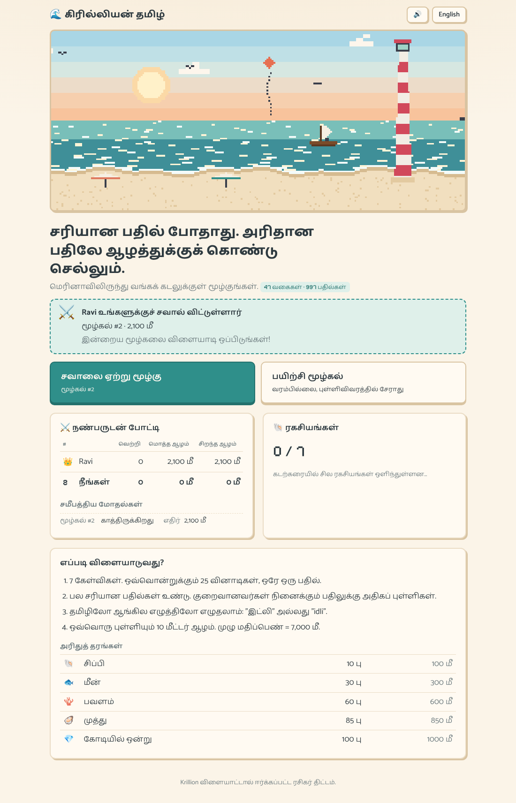
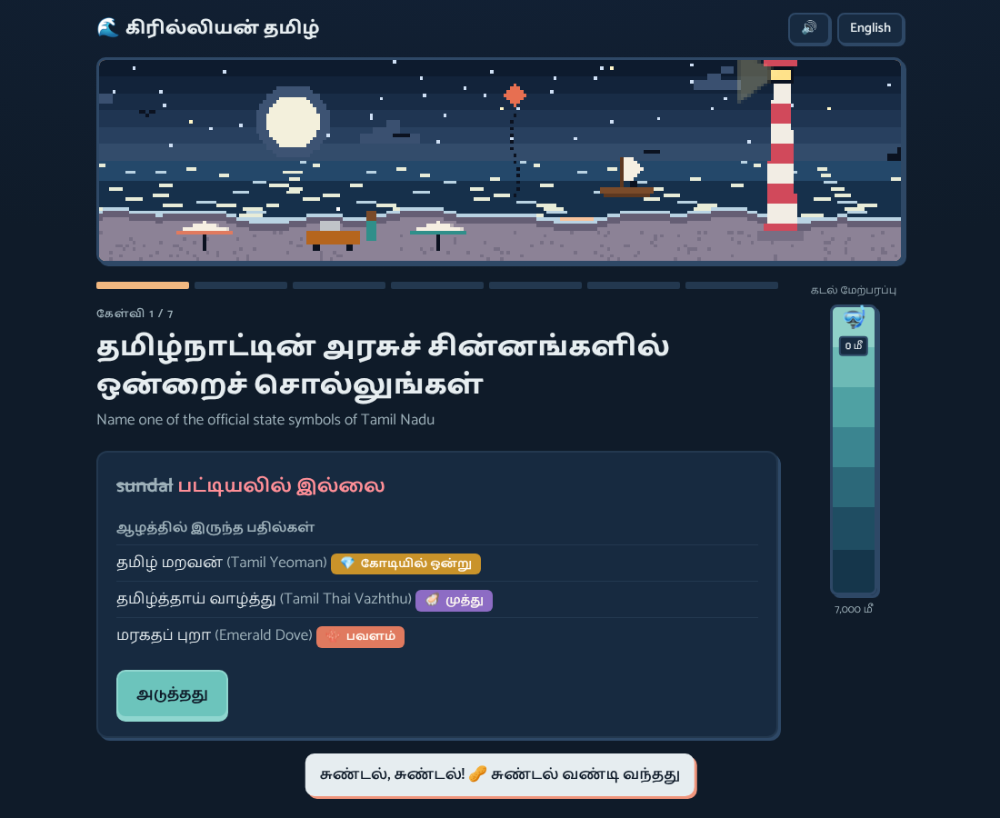
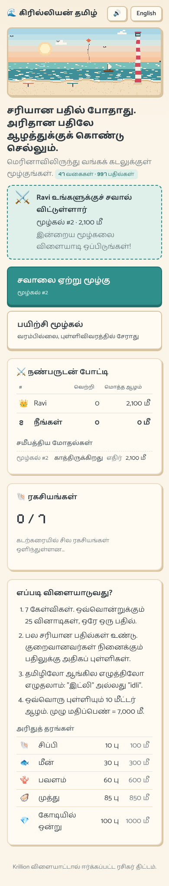
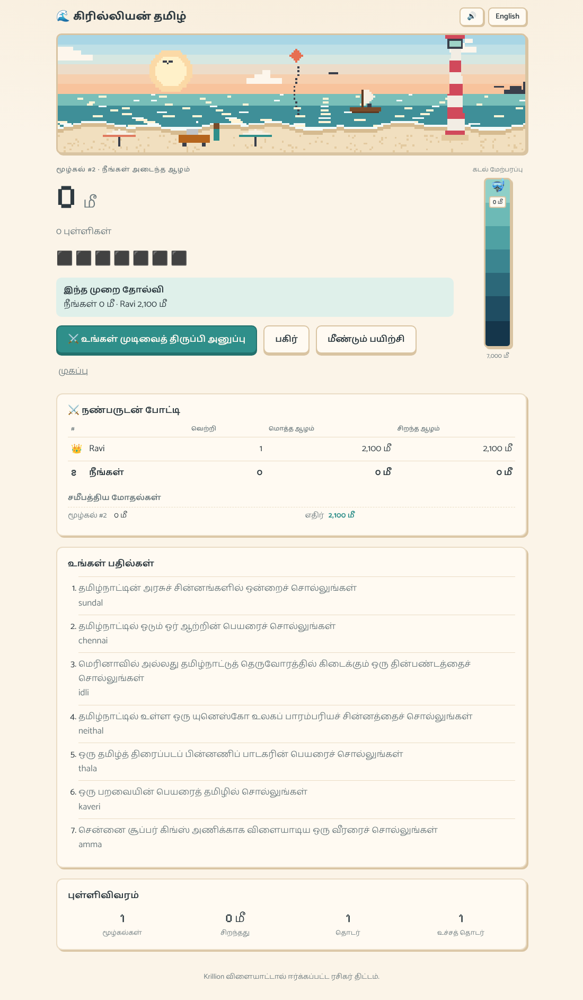

# கிரில்லியன் தமிழ் · Krillion Tamil

A daily Tamil trivia game set on Chennai's Marina Beach, where **being right is not enough: rare answers take you deeper** into the Bay of Bengal.

**Live demo:** https://psa-02.github.io/tamil-krillion/



## How it plays

Each day everyone gets the same **Daily Dive**: 7 open-ended prompts such as *"Name a district of Tamil Nadu"* or *"Name a Tamil breakfast dish"*. You have 25 seconds and one answer per prompt. Any correct answer counts, but the fewer people likely to think of it, the more it scores. Points become depth: every point is 10 metres, so a perfect dive reaches 7,000 m.

| Tier | Tamil | Points | Depth |
| --- | --- | --- | --- |
| 🐚 Shell | சிப்பி | 10 | 100 m |
| 🐟 Fish | மீன் | 30 | 300 m |
| 🪸 Coral | பவளம் | 60 | 600 m |
| 🦪 Pearl | முத்து | 85 | 850 m |
| 💎 One in a Crore | கோடியில் ஒன்று | 100 | 1,000 m |

"இட்லி" scores a Shell. "களி" is One in a Crore.

After each answer the game shows the deeper answers you missed, so every round teaches something about Tamil culture.

<p align="center"> </p>

## Friend duels

Challenge a friend without accounts or a server. After your Daily Dive, tap **Challenge a friend** and send the link (WhatsApp works well). The link carries your name, dive number and tier row. When your friend opens it, the game records your score, they play the same dive, and both of you see a head-to-head table: wins, total depth, best dive and recent duels. They can send their score back with one tap.

Links are validated (the score must match the tier row, and names are sanitised), but they're trust-based. Moving to a hosted database such as Firebase later only means swapping the storage behind [`src/lib/duel.ts`](src/lib/duel.ts).



## Features

- **Tamil-first, bilingual UI.** Tamil by default, with an English toggle; every prompt shows both.
- **Type in Tamil script or English letters.** `இட்லி`, `idli` and `idly` all match. Romanised input goes through a phonetic key (see below), and small typos are forgiven.
- **Pixel-art Marina Beach.** A hand-drawn canvas scene at golden hour: rolling waves, sun glitter, gulls, a kite, a kattumaram and the lighthouse. It switches to a starry night in dark mode.
- **Daily Dive, the same for everyone, never repetitive.** Prompts are dealt from seeded decks keyed to the date in India Standard Time, so no category comes back within three days and most return about a week later.
- **Practice Dive.** Unlimited random dives that don't touch your stats.
- **Stats and streaks** kept in `localStorage`, with safe fallbacks when storage is blocked.
- **Spoiler-free sharing**: an emoji summary via the Web Share API or the clipboard.
- **Chiptune audio.** Rising arpeggios for rarer answers, a countdown tick, soft surf while you play. Everything is synthesised with the Web Audio API, so there are no audio files, and there's a mute toggle.
- **Easter eggs.** Seven hidden surprises around the beach (see below).
- **Responsive, accessible, easy on the eyes.** Warm low-contrast palette, dark mode, `aria-live` feedback, keyboard flow, reduced-motion support.
- **47 categories, ~1,000 curated answers** about Tamil Nadu: Chennai neighbourhoods and landmarks, beaches, street food, Sangam literature, the five thinai, Carnatic ragas, folk arts, traditional games, GI-tagged products, freedom fighters, films, composers, CSK, chess grandmasters and more.

<details>
<summary>Easter eggs (spoilers)</summary>

- Answer **sundal** to anything and a sundal cart rolls onto the beach.
- Name a CSK legend: whistle podu!
- Answer **Neithal**, Marina's own landscape, in the thinai round.
- Type **kattumaram** and a boat sets sail.
- Tap the lighthouse five times.
- ↑ ↑ ↓ ↓ ← → ← → B A for Marina at night.
- Reach the full 7,000 m.

</details>

## Engineering notes

**Matching romanised Tamil.** Tamil has no single romanisation: Thanjavur, Tanjavoor and Tanjore are all in the wild. `latinKey()` in [`src/lib/match.ts`](src/lib/match.ts) folds input the way Tamil script itself folds sounds: aspirates drop (`th → t`), voiced and unvoiced stops merge (`g/k`, `d/t`, `b/p`), `zh → l`, long vowels shorten and doubled letters collapse. Keys are then compared with Levenshtein distance, with a tolerance that grows with word length (0 edits under 5 letters, then 1, then 2). If two answers are equally close, the game refuses to guess rather than award the wrong one.

**Data integrity is tested.** [`src/data/prompts/prompts.test.ts`](src/data/prompts/prompts.test.ts) checks that no two answers in a prompt share a Tamil or romanised key, so adding an alias can't silently steal another answer's matches.

**Deterministic daily puzzles with no repeats.** [`src/lib/daily.ts`](src/lib/daily.ts) seeds a mulberry32 PRNG with an FNV-1a hash and Fisher–Yates shuffles the whole prompt pool into a deck. Each day takes 7 cards, and decks are chained. Prompts dealt near the end of one deck are moved to the back of the next, so a prompt never returns within half a deck. Tests check 400 days of schedule. The timer uses a wall-clock deadline, so a throttled background tab can't stretch the 25 seconds.

**A pixel scene without image assets.** [`MarinaScene.tsx`](src/components/MarinaScene.tsx) draws a 240-pixel-wide canvas at 12 fps and lets CSS scale it up with `image-rendering: pixelated`. Waves are rows of highlights moving at depth-dependent speeds, and the shoreline is two summed sine waves. It renders one still frame when the player prefers reduced motion.

**Rarity is hand-curated.** Tiers estimate how few players would think of an answer, not how obscure the thing is. With real play data they could be recalibrated from answer frequencies.

## Tech stack

React 18, TypeScript (strict), Vite, Vitest with Testing Library, ESLint. No backend: GitHub Actions runs lint, tests and the build on every PR, and deploys `main` to GitHub Pages.

```
src/
  data/prompts/ 47 categories split by theme (Tamil + romanised aliases, rarity tiers)
  lib/          matching, scoring, daily decks, duels, easter eggs, sound, storage
  components/   MarinaScene, Home, Game, Results, DuelCard, DepthGauge, Toast
  i18n.tsx     Tamil/English strings and language context
```

## Run locally

```bash
npm install
npm run dev      # http://localhost:5173
npm test         # unit and component tests
npm run build    # production build in dist/
```

## Add a category

Add an entry to one of the files in [`src/data/prompts/`](src/data/prompts/), at the end of its list:

```ts
{
  id: 'rivers',
  ta: 'தமிழ்நாட்டில் ஓடும் ஓர் ஆற்றின் பெயரைச் சொல்லுங்கள்',
  en: 'Name a river that flows through Tamil Nadu',
  answers: [
    a('காவிரி', 'Kaveri', C, 'Cauvery'),   // Tamil, English, tier, ...aliases
    a('குண்டாறு', 'Gundar', K, 'Kundar'),
  ],
},
```

Run `npm test`. It fails if any of the new answers clash with each other.

## Credits

A fan project inspired by the trivia game Krillion. It is not affiliated with Krillion's makers. All prompts, answers and rarity tiers here are original.
